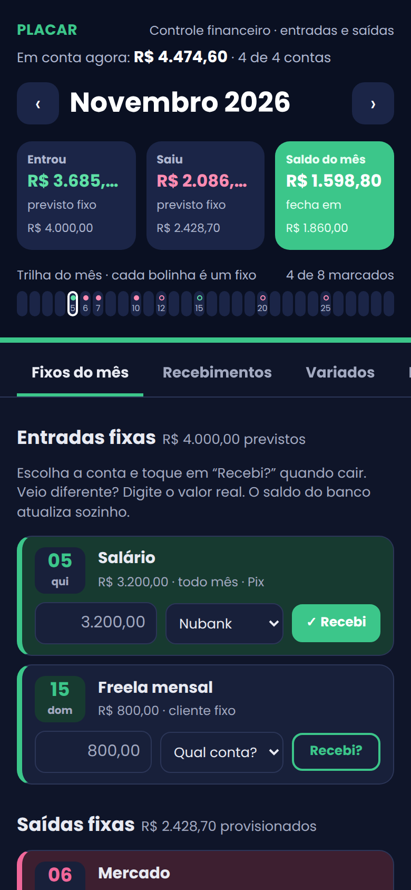
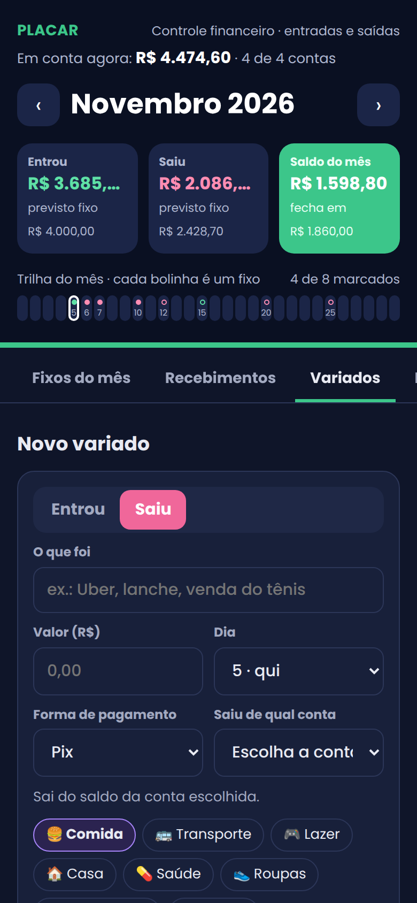
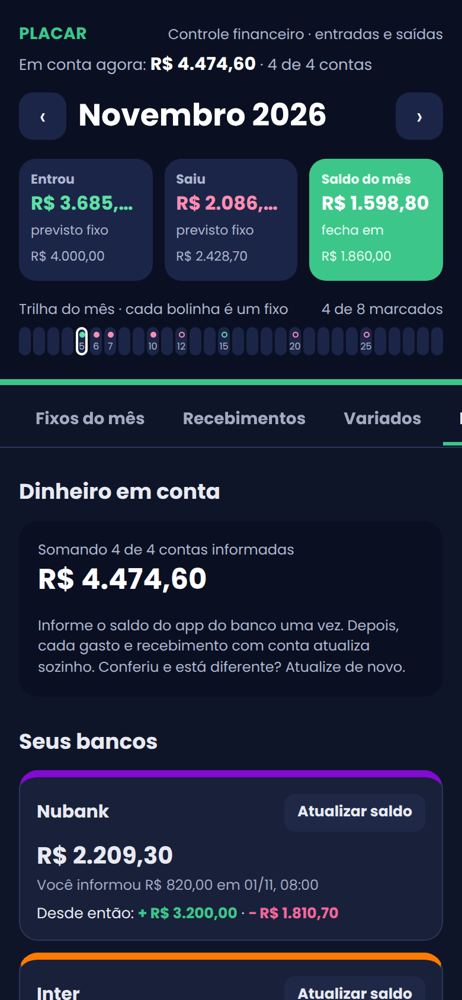
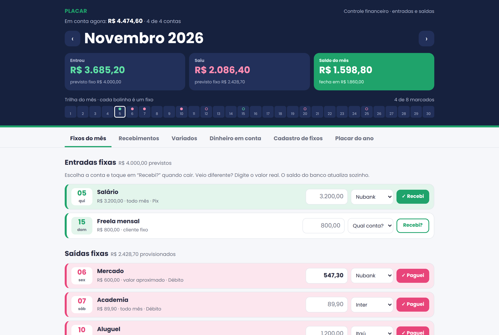

# Placar Financeiro

Controle financeiro pessoal em uma página só: fixos do mês, recebimentos extras, gastos do dia a dia, saldo de cada banco e um placar do ano. Funciona no navegador do computador e do celular (dá para adicionar à tela inicial como um app), com modo claro e escuro.

**[Abrir a demonstração](https://amandamrct.github.io/Financial-Scoreboard/)**

<p>
  
  
  
</p>



## Sobre o projeto

O Placar nasceu de um caso real: um controle financeiro feito para um cliente que queria parar de anotar tudo em papel e acompanhar o mês pelo celular. A ideia central é simples: o que é fixo já vem provisionado, o que é variado se anota na hora, e o app mostra quanto vai sobrar no fim do mês antes de o mês acabar.

Todos os valores, nomes e bancos deste repositório são fictícios.

## O que ele faz

- **Fixos do mês:** entradas e saídas recorrentes, com parcelas (por exemplo, 10x de R$ 289,90) que somem sozinhas depois da última. Cada fixo é marcado como "Recebi" ou "Paguei", com o valor real e a conta.
- **Recebimentos extras:** serviços, rendimentos, intermediação, captação de cliente, com a conta de destino.
- **Variados:** gastos e entradas do dia a dia, com categoria, forma de pagamento (Pix, débito, crédito, boleto, dinheiro) e conta.
- **Dinheiro em conta:** saldo de cada banco, atualizado automaticamente a cada lançamento. Gastos no crédito ficam separados até a fatura ser paga.
- **Transferências** entre as próprias contas, sem contar como gasto ou ganho.
- **Previsão do mês:** quanto entrou, quanto saiu, e quanto o mês fecha considerando o que ainda falta cair ou vencer.
- **Trilha do mês:** uma linha com os dias, mostrando quando cada fixo cai.
- **Placar do ano:** os 12 meses lado a lado, previsto e realizado.
- **Backup:** exportar e restaurar tudo em um arquivo `.json`.

## Como foi feito

- **HTML, CSS e JavaScript puros**, em um único arquivo (`index.html`), sem framework e sem etapa de build.
- **Layout responsivo**, pensado primeiro para o celular, com áreas seguras do iPhone (`env(safe-area-inset-*)`) e tema claro/escuro por variáveis CSS.
- **Três modos de salvar**, escolhidos automaticamente:
  1. **Neste navegador** (`localStorage`): é o modo da demonstração.
  2. **Firebase** (Authentication + Cloud Firestore): login por e-mail e senha, dados na nuvem e sincronizados entre aparelhos. As regras de segurança deixam só o dono ler e gravar.
  3. **Artefato do Claude**: publicado como página no claude.ai, com os dados na área privada da conta do usuário e uma **tela de PIN**. O PIN nunca é salvo em texto: é guardado como hash PBKDF2-SHA-256 com salt aleatório (Web Crypto API), tranca de novo depois de 1 minuto fora do app e espera 30 segundos após 5 tentativas erradas.
- **Acessibilidade:** botões com rótulos, regiões `aria-live` para avisos, navegação por teclado no PIN.

## Rodar no seu computador

Baixe o repositório e abra o `index.html` no navegador. Não precisa instalar nada. Na primeira vez, toque em **Carregar fixos de exemplo** para ver o app funcionando.

## Usar com seus próprios dados na nuvem

O passo a passo para ligar ao Firebase e publicar com domínio próprio está em [`guia-firebase.md`](guia-firebase.md). As regras de segurança do banco estão em [`firestore.rules`](firestore.rules).

## Estrutura

```
Financial-Scoreboard/
├── index.html           o app inteiro
├── guia-firebase.md     como colocar no ar com login e nuvem
├── firestore.rules      regras de segurança do banco
├── *.png                imagens deste README
└── LICENSE
```

## Autora

**Amanda Maricato** · UX/UI designer e estudante de Ciência da Computação

[LinkedIn](https://www.linkedin.com/in/amanda-maricato-175b1b1b5/) · [Behance](https://www.behance.net/amandamaricato) · [GitHub](https://github.com/amandamrct)
